# 散页 Unbound

一只小陶灵「小克」，在碎掉的宇宙图书馆里飞行、射击、挖矿、保暖，把散落的书页拾回来。

> **项目状态：已归档（2026-11）。** 这是 Eric 和 Claude 一起做着玩的像素游戏，玩法已经比较完整，暂时不再更新。网页版会一直挂着能玩。想接着做，看文末的「以后想接着做」。

> **非官方粉丝作品**：这是一个个人做着玩的非盈利小游戏，和 Anthropic 没有任何关系，也没有得到 Anthropic 的认可或赞助。主角「小克」的形象参考了 Claude 的橙色吉祥物，相关商标和形象归 Anthropic 所有。

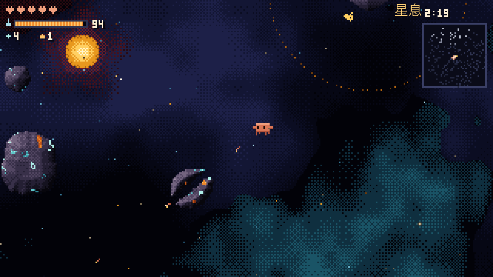

## 在线试玩

网页版：**https://nuetraine.github.io/sanye/** （电脑浏览器最好；手机浏览器也能玩，横屏）

标题画面有两种玩法：
- **主线探索**：八章地图，飞行、挖矿、保暖、打首领、装订失落之页。下面「操作」到「字句构筑」都是主线的内容。
- **暗潮试炼**（幸存者模式）：标题右上角的按钮或按 V 进入。自动攻击、怪海、升级三选一，一局约 15 分钟。见下面「暗潮试炼」一节。

## 这个项目做了什么

| 时间 | 内容 |
| --- | --- |
| 2026-11-08 | 单文件网页原型（[`prototype/散页.html`](prototype/散页.html)）：一章、8 种生物、体温与暗潮、三张失落之页 |
| PR #1 | 用 Godot 4 重写，640×360 像素画面、存档、字句构筑、第二章、五种笔、四只陶灵 |
| PR #2、#3 | 第三章、主动技能、暗潮生物、笔和字的联动 |
| PR #4 | 9 种小行星和矿脉带，第四到第八章，图鉴 46 种生物、八个首领 |
| PR #5 | 幸存者模式「暗潮试炼」：一张地图八阶段八首领、七支笔各两种进化 |
| PR #6 | 试炼里首领之间的炉灯工坊、25 种藏品、吸页石、暗潮等级 0–5 |
| PR #7 | 升级节奏放慢、满级强化、开局誓约、地图事件点、卡片封存与跳过、结算伤害统计 |

当前版本就是 `main` 分支（PR #7 之后），网页版也是从它导出的。最早的单文件网页原型留在 `prototype/`，直接用浏览器打开就能玩。

## 怎么运行

1. 安装 Godot 4.7（Mac 上：`brew install --cask godot`）
2. 打开 Godot → 「导入」→ 选这个文件夹里的 `project.godot`
3. 按右上角的 ▶（或 F5）运行

也可以在终端里直接运行：

```bash
godot --path .
```

## 操作

| 电脑 | 手机 |
| --- | --- |
| WASD 移动 | 屏幕左半边拖动 |
| 鼠标瞄准、左键射击 | 屏幕右半边按住（朝手指方向射击） |
| 空格 / Shift / 右键 冲刺 | 右下角「冲」 |
| Q 吃一颗余烬回暖 | 「烬」按钮 |
| B 放下信标 | 「标」按钮（有信标时出现） |
| C 在炉灯旁换角色 | 「角色」按钮 |
| E 在炉灯旁打开工坊 | 点炉灯下方的「工坊」字样 |
| F 句子面板（换字） | 点左下角的句子 |
| X 放技能 / Z 换技能 | 左下角「技」按钮 / 点技能框 |
| Tab 生物图鉴 | 点右上角小地图 |
| M 静音 | |

## 目标

找回三张失落之页，带回炉灯装订：
- 「论寒冷」在东边的蛭环，一窝轨道蛭守着它
- 「论引力」在西南的坍缩苗圃，旁边有两只引力胎
- 「论回声」封在北边的茧里，要先打败首领回声蛇

## 矿脉带和各种小行星

第一章西边新开了一片「矿脉带」：石头最密、晶洞和陨铁最多，还会下流星雨（屏幕上出现箭头就躲到石头背面，流星砸碎的石头里有余烬）。

小行星现在有 9 种样子：碎石、长条石、陨坑石、页岩、熔岩石、陨铁、晶簇、晶洞、苔石，按区域分布。矿也分三种：
- 青色页尘矿：普通。
- 金箔矿（闪金光）：页尘多很多。
- 字晶（紫色发光）：偶尔能敲出一个字。

新生物：
- **石蜗**：沿石头表面爬，啃矿。靠近会缩壳，过一会儿吐石子；打死会把吃下的页尘吐出来。
- **钻岩虫**：躲在大石头里，你经过时破石而出，钻出一条隧道。
- **彗尾鱼**：拖着光尾巴，胆小会逃，追上能拿余烬。

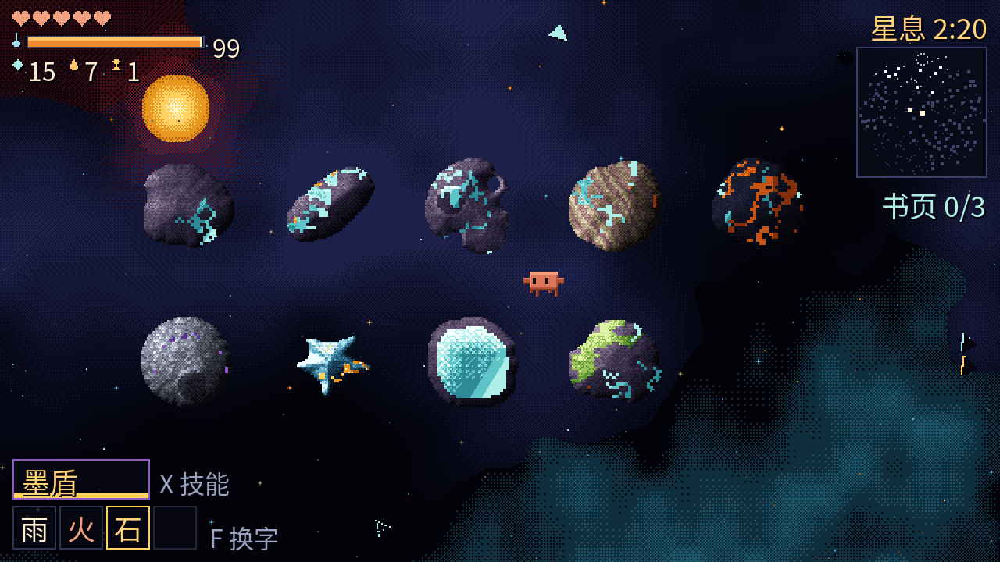

## 第二章「阅览室残骸」

装订完第一章的三张书页后，炉灯会跟着你翻到第二章（之后在炉灯边按 G 可以来回翻章）：
- **书架迷宫**（东边）：一排排可以打碎的书架，发青光的书里夹着页尘。书虫会啃穿书架追你。
- **熄灯区**（西南）：很暗。朝路灯开一枪能点亮它一分钟；灯魇只有在亮处才打得到。
- **墨海**（北边）：墨池会拖住脚步，墨团打散后裂成两团小的。首领「删节者」守着最后一页：看到细线就躲开，一眨眼后那里会落下删除线。

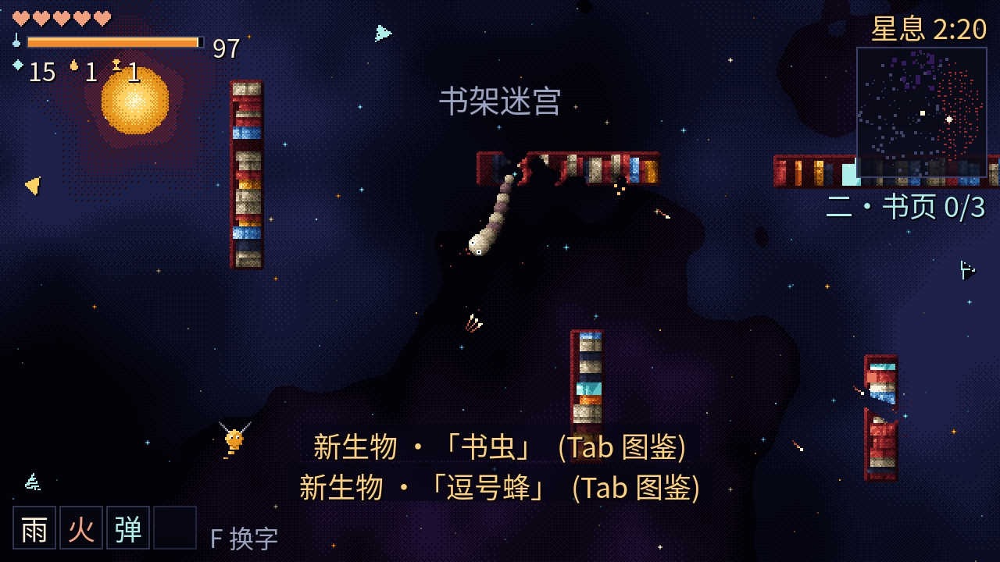

## 第三章「烛芯钟楼」

装订完第二章，炉灯翻到第三章（在炉灯边按 G 轮流翻三章）：
- **页风回廊**（东边）：一道道看得见的风会把你和掉落物吹走，顺风飞很快，逆风很难。信鸽页成群俯冲。
- **齿轮钟室**（西南）：巨大的钟面上指针一直在转，碰到会被弹开受伤，指针也会挡子弹。发条甲虫壳很硬，等它冲撞完累了（壳打开）再打。印章兽会跳起来砸地，落地放出一圈冲击波，冲刺能穿过去。
- **烛焰台**（北边）：一点不冷，但每隔一阵会下火雨。看到火星预警就躲到石头下面。烛芯虫在火雨里会回血。首领「装订师」守着最后一页：它会射针、拉线、钉出五角星形的红线，线变亮之前离开。

新书页：「论风向」冲刺冷却变短，「论时间」技能冷却变短，「论余温」通关第三章。

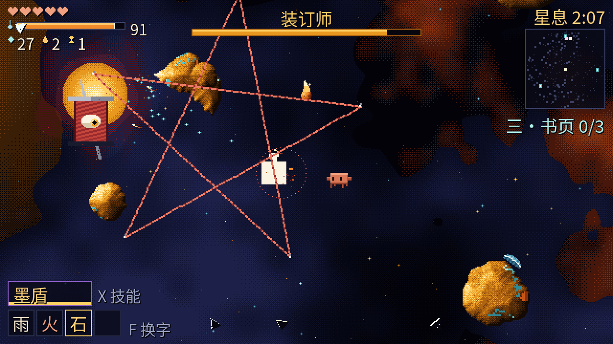

## 暗潮生物

暗潮来时，除了蚀字蛾还会有：
- **冷息**（第 1 次暗潮起）：一团冷气，贴着你吸体温，不掉血；怕信标的光，打散掉一颗余烬。
- **霜棱**（第 2 次起）：停下来拉出一道瞄准线，然后直线撞过来；撞到石头会碎。
- **扑灯母**（第 3 次起）：大蛾子，专啃信标，一边飞一边抖下新的蚀字蛾。必掉一个字。

暗潮结束时它们都会散掉。

## 笔和字的联动

毛笔、排刷吃句子里所有的字。刻刀、砚雷、墨线除了吃火/霜/静/蚀/暴，还有各自的联动（按 F 看当前生效的）：

| 字 | 刻刀 | 砚雷 | 墨线 |
| --- | --- | --- | --- |
| 针 | 刀更长 | 扔得更远更快 | 蓄力更快 |
| 雨 | 刀扇更宽 | 一次扔三颗 | 一次射三道 |
| 石 | 伤害更高 | 炸得更大 | 更粗、伤害更高 |
| 环 | 回旋斩一圈 | 原地再炸一次 | 墨线留在原地持续伤害 |
| 穿 | 斩出飞行剑气 | 穿过敌人到落点才炸 | 钻石头更深 |
| 回 | 反手补一刀 | 炸完弹回来再炸 | 自动补一道 |
| 寻 | 扑向最近的敌人 | 拐向敌人 | 自动瞄准 |
| 裂 | 砍中裂出小字弹 | 炸开裂出小字弹 | 命中处裂出小字弹 |
| 弹 | 把敌弹打回去 | 撞石头弹开 | 撞石头折射 |
| 连 | 电到旁边的敌人 | 电到旁边的敌人 | 电到旁边的敌人 |

## 第四到六章

每章装订完三张书页就会翻到下一章，在炉灯边按 G 可以在已解锁的章节间轮换。

**第四章「冰封书库」**：比别处更冷，靠冒热气的暖泉取暖。
- 冰湖：冰面打滑，松开方向键也会一直滑。
- 霜柱林：霜柱会慢慢长出来挡路，过一阵裂开炸成冰碴，可以打碎。
- 极光原：非常冷，只有飘动的极光下面是暖的。
- 生物：冰蛛（吐网让你变慢）、雪球兽（越滚越大，引它撞石头）、霜蝠（成对俯冲）。首领「索引柜」：抽屉飞卡、网格线、暴风雪。

**第五章「镜之回廊」**：
- 棱镜林：镜子会把字弹弹回来，弹回来的会打到自己；也可以用来拐弯打敌人。
- 回声谷：影子踩着你一秒多以前的脚印追你，别停、别回头。
- 生物：拟字兽（装成页尘，会咬掉页尘）、棱镜虫（光弹半路散成三色，挨打会闪现）、碎镜片（成群反弹）。首领「镜中人」：站在你正对面学你开枪、冲刺，还会在你身边立镜子。

**第六章「残烛之心」**：不冷，但到处是火。
- 熔页海：熔页池一涨一缩，踩上去会烫伤。
- 灰烬原：周期性的灰烬风暴，看不远、被风推着走。
- 烛心：一道耀斑慢慢扫过，躲到石头后面。
- 生物：火蜥（身后留火痕）、灰烬魂（忽隐忽现，死后炸开）、烛泪（不会动，朝你脚下甩蜡）。首领「残烛之芯」：三个阶段，螺旋火、落蜡、光轮。

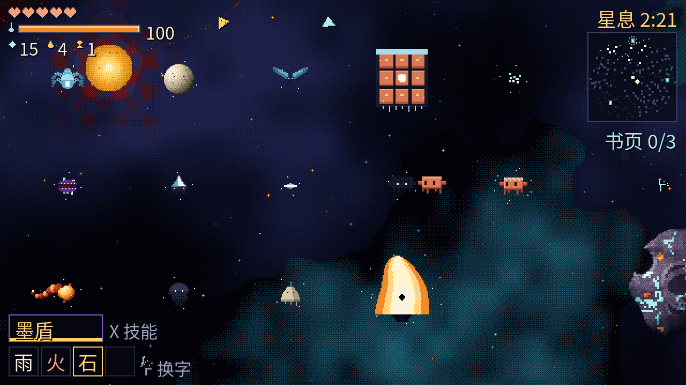

## 第七、第八章

**第七章「墨渊深井」**：被洗掉的字都流进了这口井。
- 墨藻林：墨藻缠脚，走不快，冲刺能挣开。
- 漩涡滩：漩涡把你往里卷，中心会伤人。
- 渊底：很暗，墨云里更看不清。
- 生物：灯笼鱼（用饵光装成页尘，靠近就猛扑）、墨胆（朝八个方向射刺）、墨鳗（先画线再带电冲过去）、墨鱿（吐墨团，挨打喷墨逃跑）。
- 首领「墨渊」：触手依次横扫、墨雨、在你脚下开漩涡，共三个阶段。

**第八章「沉默视界」**：最重的字沉进了黑洞。
- 吸积盘：整片在转，推着你走，夹着烧红的碎块。
- 透镜原：脉冲星隔几秒放出一圈波；星座的两颗星之间会连成一道光。
- 视界：越靠近黑洞，被拉得越用力。
- 生物：卫星虫（绕着你转圈开枪）、新星（越胀越大然后炸开）、双子（两只之间拉着一道伤人的光）。
- 最终首领「静默」：把子弹从外圈往里吸、连发引力波、星座网、喷流，共三个阶段。

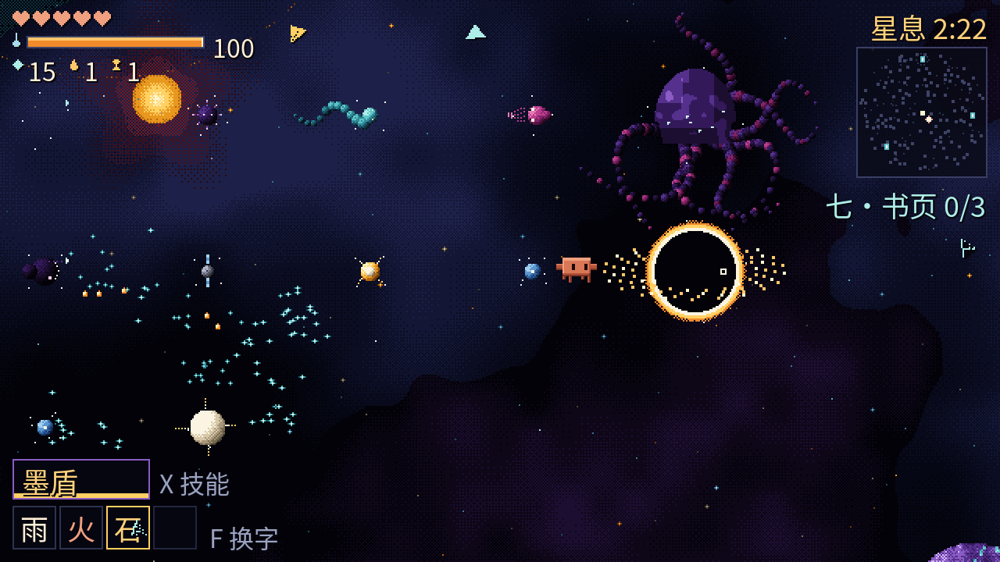

## 主动技能

工坊新增「炉印」（最多 3 级），每级多解锁一个技能。X 放技能，Z 换技能：
- **墨盾**：3 秒无敌，并吃掉身边的敌弹
- **炉息**：以自己为中心爆一圈火，伤害加点燃，顺便回暖
- **定格**：所有生物和敌弹停 3 秒
- **万页**：放出 12 片绕身飞的纸页，会自己追敌人

## 四只陶灵

在炉灯边按 C（手机点「角色」）可以随时换一副陶身，升级、字和书页都带着走：

| 角色 | 特点 |
| --- | --- |
| 小克 | 均衡 |
| 小瓷 | 飞得快、冲刺恢复快、不怕冷，少一颗心 |
| 阿砖 | 多两颗心、飞得慢，冲刺能撞伤敌人、撞碎石头 |
| 墨墨 | 句子多一格、不怕墨池，少一颗心、冷得更快 |

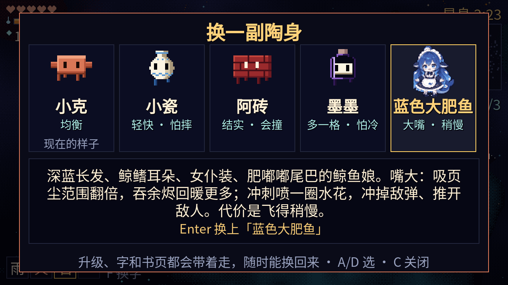

## 五种笔

工坊的「笔架」每升一级多一支笔，数字键 1–5、R 或滚轮换笔（手机点左下角的笔名）：

| 笔 | 打法 |
| --- | --- |
| 毛笔 | 一发一发的字弹，句子里的字全都生效 |
| 排刷 | 一次刷出一片短射程的字弹 |
| 刻刀 | 身前挥一刀，伤害高，能劈开敌人的子弹 |
| 砚雷 | 朝准星扔一团墨，炸开一片 |
| 墨线 | 按住蓄力，松开射出一道穿透一切的墨线 |

## 字句构筑（M2）

生物和工坊「炼字」会给你「字」。字填进左下角的句子里，句子决定字弹的效果：

- **形**（子弹长什么样）：针、雨、石、环。一句话只有第一个形字算数。
- **动**（子弹做什么）：穿、回、寻、裂、弹、连。
- **性**（附加效果）：火、霜、重、静、蚀、暴。
- **成词**：相邻两个字拼成真词有额外效果，目前有「穿针」「火石」「回环」「重回」「裂石」「连环」「暴雨」「寻回」「重弹」。
- **金色字**：约 5% 的字是金色，效果翻倍；首领必掉金色字。
- 在外面只能往空格里填字，回到炉灯才能把字取下来重排。工坊的「句槽」升级让句子多一格，最多 5 格。

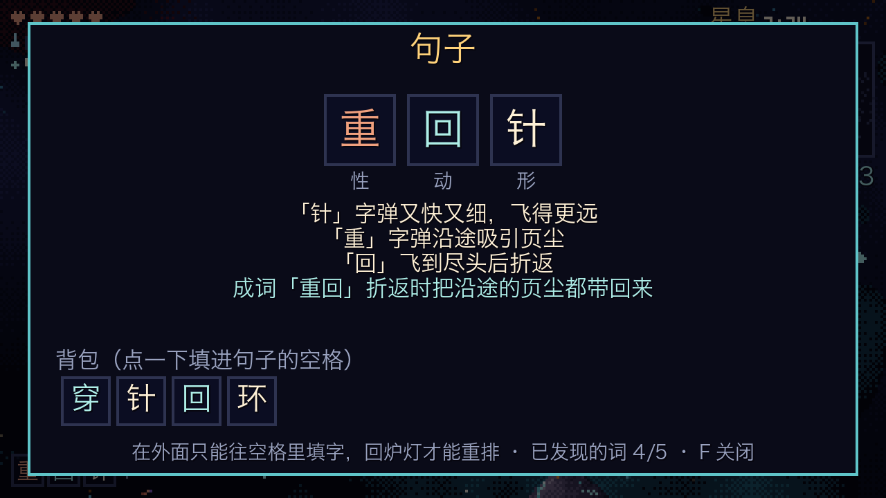

所有字、词、掉落率都在 [`data/words.json`](data/words.json) 里，改这个文件就能调，不用改代码。

## 暗潮试炼（幸存者模式）

把主线里的生物、笔、字、首领装进一张不停涨潮的地图里。只管走位，笔会自动出手。

**一局的流程**：约 15 分钟，分八个阶段，每段 105 秒。每段开始 30 秒出精英怪（掉吸页石，一下吸走全场页尘），52 秒来一次小事件，75 秒出这一章的首领（回声蛇、涂改者、装订者、索引柜、镜中人、残烛之芯、墨渊海怪、沉默）。46 种生物按阶段混进怪海。打倒最后的「沉默」算通关。

**操作**：WASD 移动，空格或 Shift 冲刺，Esc/P 暂停。升级时 1–3 或 A/D 选卡、回车确认，R 重掷，X 封存，C 跳过。

**构筑**（升级三选一）：
- **七支笔**：毛笔、排刷、刻刀、砚雷、墨线、印章、烛台，最多带 4 支，各 5 级。满级后配上搭档字可以「成词进化」，每支笔有两种进化（比如毛笔 + 雨 = 暴雨，刻刀 + 环 = 回环）。
- **15 个字**：形（针雨石环）、动（穿寻裂连）、性（火霜暴重）、身（疾炉心），最多 6 个。两个字凑齐自动成词，共七个：火石、连环、冰裂、锋芒、厚土、追魂、风火。
- **四个自动技能**：墨盾、炉息、定格、万页，最多带两个，各有一个能加成它的字。
- **满级强化**：笔、字、技都练满后，升级用快手、扩印、健步、厚胎、聚墨补满三选一，可以一直叠。

**誓约**：开局三选一（也可以不立），一条规矩管一整局，有得有失。八种：独笔、薄胎、群潮、贪墨、博学、疾书、慢热、藏家。比如「独笔」伤害 +50% 但只能带两支笔。

**地图事件点**：每个阶段地图上会冒出两个圈，走进去站一会儿才生效，去不去自己定：
- 试炼圈：守住 7 秒，得一张散页。
- 诅咒碑：招来 30 秒怪潮，换一次淬火和 30 墨滴。
- 暖泉：站进去慢慢回心。
- 字碑：读 2.5 秒，白拿一次升级。

**封存与跳过**：升级时按 X 封存一张卡，这一局不再出现（每局 2 次），用来把卡池收窄到想要的构筑；按 C 跳过这次升级，换 15 墨滴。

**炉灯工坊**：每打倒一个首领开一次门，用路上攒的墨滴买藏品。25 种，很多有得有失（镇纸伤害 +12% 但跑得慢，玻璃笔伤害 +35% 但挨打多掉一颗心）。

**局外成长**：每局带回「书页」，在营地买六项永久升级（陶壳、笔锋、悟性、磁石、重掷、余火）；四只陶灵开局的笔和特点不同。通关解锁「暗潮等级」，最多 5 级，一级比一级难。结算画面有伤害来源统计。进度存在 `user://sanye-surv.json`。

**颜色约定**：我方攻击是偏暗的青白色，敌方子弹、预告线、危险区一律是品红色。

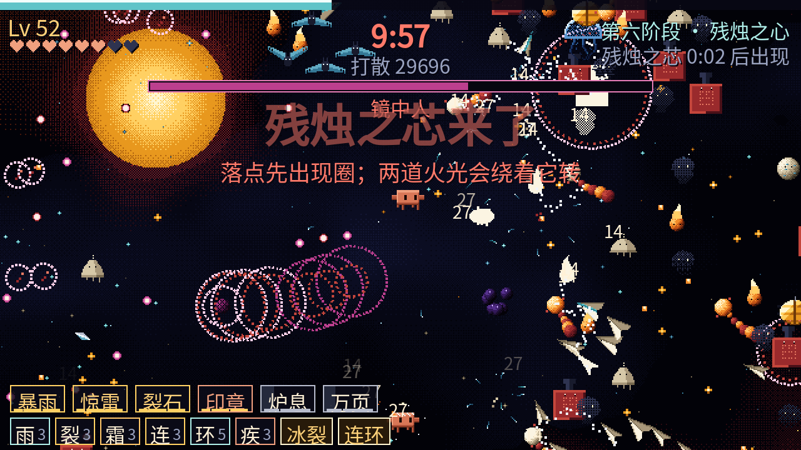

## 目前进度

网页原型的玩法已经全部移植到 Godot：
- 640×360 精细像素画面（原型的两倍精细），整数倍放大不会糊，并且铺满整个窗口不留黑边
- 进度自动存档：升级、字、书页、信标都会记住，下次打开可以「继续旅程」
- 移动、冲刺、射击；小行星逐像素可打碎，带实时光照
- 体温、炉灯暖圈、暗潮循环（150 秒一轮）、冻伤与死亡重生
- 炉灯工坊 6 种升级：信标、炉火、字弹、陶壳、保温釉、喷气孔
- 八章地图，共 46 种生物（含八个首领）
- 4 个主动技能（工坊「炉印」解锁）
- 三张失落之页与装订效果、结局画面、生物图鉴、通关次数存档
- 程序化合成的音效与背景低音；手机触屏操作

还没做：辉光特效、远景的图书馆残骸、安卓导出。另外有完整的幸存者模式，见上面「暗潮试炼」。

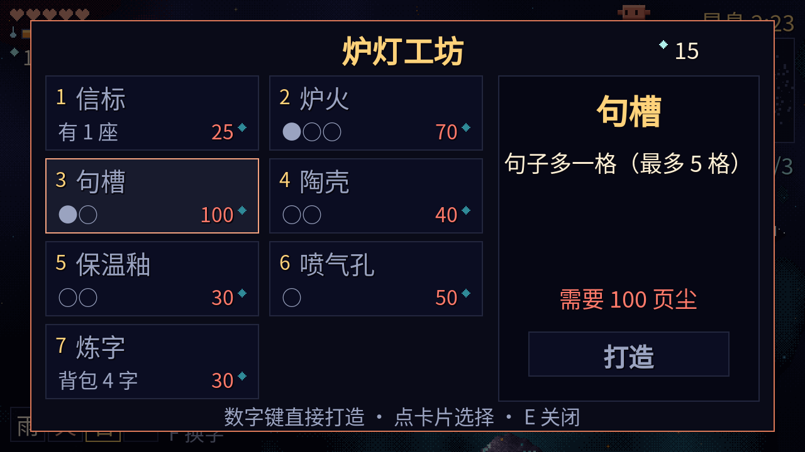
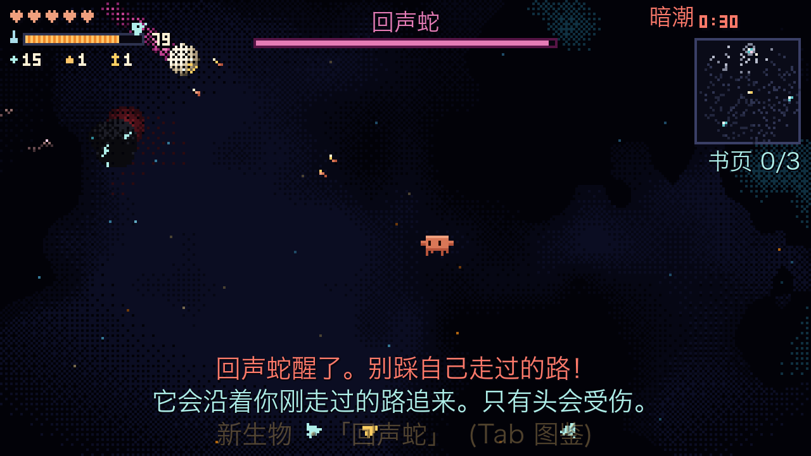
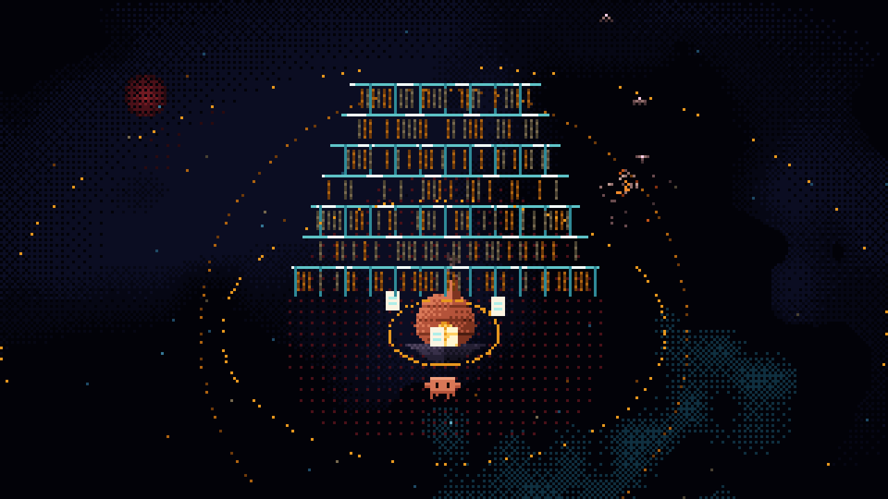

## 仓库结构

```
project.godot          Godot 项目配置（Godot 4.7）
main.tscn              主场景（主线探索）
surv.tscn              暗潮试炼的场景
export_presets.cfg     网页版导出设置
scripts/game.gd        入口：搭场景、输入、主循环、自动试玩和各种测试开关
scripts/game_hud.gd    界面：状态栏、工坊、句子面板、图鉴、标题、结局
scripts/game_art.gd    世界里的像素绘制：炉灯、生物、子弹、小克（先烤成小贴图再贴）
scripts/game_state.gd  主线玩法：世界生成、八章、玩家、生物、字句构筑、子弹、存档
scripts/surv.gd        暗潮试炼：继承 game.gd，阶段、笔、字、誓约、事件点、工坊、营地
scripts/rock.gd        可破坏的小行星
scripts/pal.gd         调色板、抖动矩阵、噪声
scripts/sfx.gd         程序化音效
shaders/               远景、小行星打光、精灵查色板、暗潮压暗、fx（圈/光束/虚线一次画完）
data/words.json        主线字句构筑的数据表
fonts/                 思源黑体
docs/                  README 用的截图
prototype/散页.html    最初的单文件网页原型
tools/publish_web.sh   导出网页版并推到 gh-pages
```

所有画面都是代码画的，没有美术素材文件。

## 测试用

```bash
godot --path . -- --autoplay
```

会自动开始游戏、乱飞乱打，并把几张截图存到 Godot 的用户数据文件夹，然后自动退出。

另外两个测试开关：

```bash
godot --path . -- --autoplay --gallery   # 把八种生物摆在炉灯旁拍一张“全家福”
godot --path . -- --bot --bot-secs=900   # 机器人快进乱玩 15 分钟，用来揪运行时报错
godot --path . -- --autoplay --ch=3      # 直接进第三章，拍各区域和首领并走完通关流程（--ch=4 到 8 同理）
godot --path . -- --autoplay --mobs      # 第四到六章的生物和首领摆在一起拍一张（加 --ch=7 拍第七、八章的）
godot --path . -- --autoplay --belt      # 各种小行星、矿脉带的新生物和流星雨
godot --path . -- --autoplay --tide      # 直接来第三次暗潮，拍冷息、霜棱、扑灯母
godot --path . -- --autoplay --penfx     # 刻刀/砚雷/墨线配不同句子各拍一张
```

暗潮试炼的测试开关（`--fast=N` 是 N 倍速，界面截图用 1 或 2）：

```bash
godot --path . -- --surv --autoplay --fast=8            # 机器人打一整局，截图并打印结果
godot --path . -- --surv --autoplay --fast=8 --god      # 无敌，用来看后期和首领
godot --path . -- --surv --autoplay --hub               # 拍营地界面
godot --path . -- --surv --autoplay --char=2 --pact=solo  # 指定陶灵和誓约
godot --path . -- --surv --autoplay --hurtlog --noshot  # 打印挨打来源，不截图
```

### 在没有显示器的 Linux 上跑（云端用的方法）

1. 装 Godot 4.7.2 的 Linux 版和对应的 Web 导出模板。
2. 用 xvfb 套一层虚拟屏幕：
   ```bash
   xvfb-run -a godot --path . --rendering-driver opengl3 --resolution 1280x720 -- --autoplay
   ```
   截图会存到 Godot 的用户数据文件夹（`~/.local/share/godot/app_userdata/散页 Unbound/`）。
3. 导出网页版再用浏览器试：`godot --headless --export-release Web export/web/index.html`，然后用 Playwright 打开（Chromium 加 `--use-angle=swiftshader`）。

### 网页原型的试玩脚本

原型 `prototype/散页.html` 有调试钩子 `window.__game`（`step(n)` 不渲染直接推进逻辑）。配套的 Playwright 脚本（机器人连玩、截图、测帧耗时）不在仓库里，放在归档包 `sanye/tools/` 里，用法见那里的 README.txt。

## 发布网页版

```bash
tools/publish_web.sh
```

会导出网页版并推到 `gh-pages` 分支，GitHub Pages 自动更新。

## 联机模式（评估过，没做）

评估过给暗潮试炼加两人合作，结论：
- **难点**：`surv.gd` 全部围绕单个主角 `P` 写的：怪追谁、镜头跟谁、升级三选一的等级和卡都只有一份。任何联机都要先改成支持多个主角。
- **方案一：同屏双人**（推荐先做）。一台电脑两个人，一个键盘一个手柄。改动最小，大约一轮工作量，不需要服务器。
- **方案二：网页点对点**（第二步）。用 Godot 的 `WebRTCMultiplayerPeer`，主机算全部模拟，客机只传输入。需要一个「牵线」的方式让两边连上：免费的 Cloudflare 账号，或者互相复制粘贴邀请码。
- **方案三：专用服务器**。要月费和维护，不推荐。

建议路线：先做同屏双人，把「多主角」改好，再在上面接 WebRTC。

## 以后想接着做

1. **跑起来**：装 Godot 4.7，导入 `project.godot`，F5。暗潮试炼在标题右上角。
2. **先看哪里**：主线逻辑在 `scripts/game_state.gd`，试炼在 `scripts/surv.gd`。试炼的数值都是文件开头的大表（`STAGES`、`SPENS`、`SW`、`WCOMBO`、`SK`、`RL`、`PACT`、`POIK`、`META`），改表就能调。
3. **改完怎么验**：`--surv --autoplay --fast=8` 让机器人打一局；主线用 `--bot --bot-secs=900` 快进找报错。
4. **发布**：`tools/publish_web.sh`（需要 Web 导出模板和推送权限）。

没做完、可以接着做的：
- 试炼难度仍偏易（机器人几乎每局通关），怪的血量曲线在 `surv.gd` 里，可以再陡一些。
- 玩家反馈过：帧率、清晰度、敌我弹幕区分还可以再改进（已经做过一轮）。
- 怪加描边、更多陶灵和笔、成就解锁。
- 主线：辉光特效、远景的图书馆残骸、炉灯合成菜单、安卓和电脑安装包。
- 联机（见上一节）。
- 设计文档（PRD）和世界观设定写在 Claude 文档里，没有放进仓库。

## 姐妹项目《鲸落》

同一时期还做了一个单文件网页小游戏《鲸落 Whalefall》：一颗坠落的星沉入深海峡谷，点亮 22 种深海生物，带收集和构筑玩法。它不在这个仓库里，在归档包的 `whalefall/` 里（`鲸落.html` 双击就能玩，`sprites/` 是导出的精灵包）。

## 许可证

内置字体是思源黑体（Noto Sans SC），按 [SIL Open Font License](fonts/OFL.txt) 授权。

游戏本身 [CC BY-NC 4.0](LICENSE)：可以复制、修改、转发，但要署名，且不能商用。「小克」形象归 Anthropic 所有，不在授权范围内。
