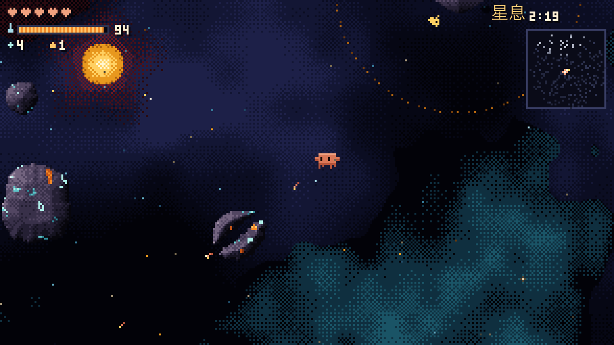
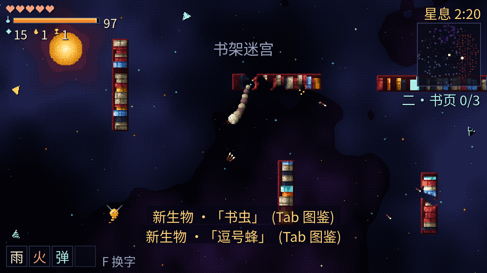
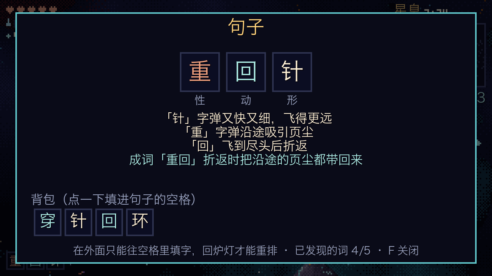
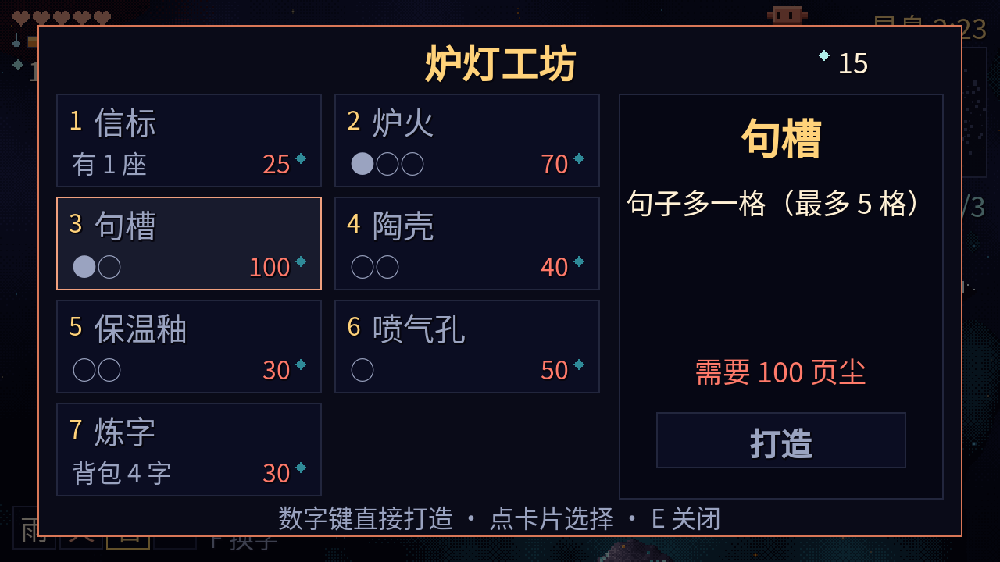
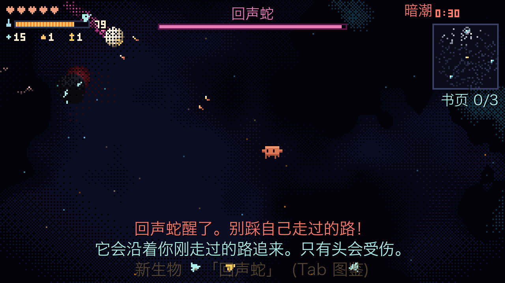
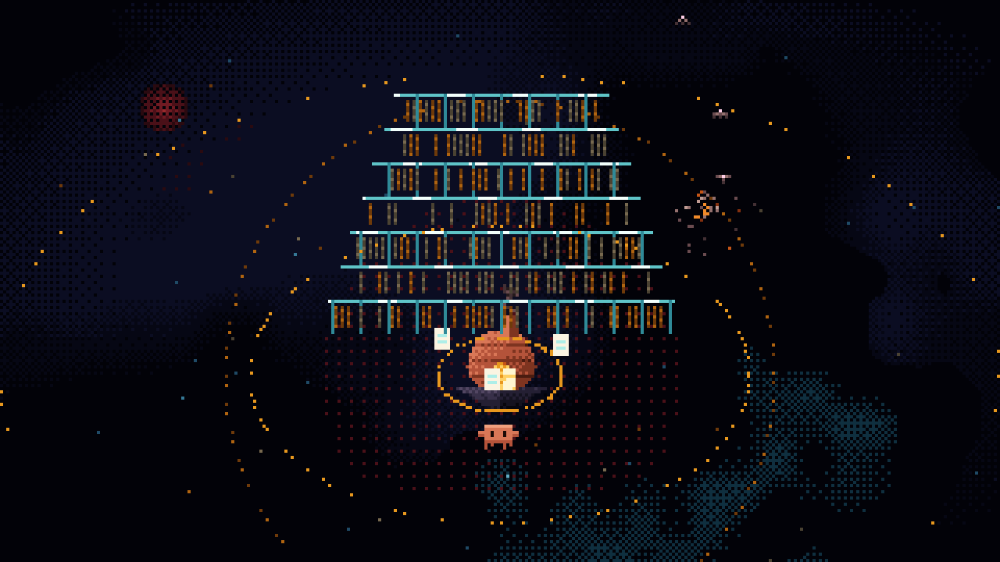

# 散页 Unbound

一只小陶灵「小克」，在碎掉的宇宙图书馆里飞行、射击、挖矿、保暖，把散落的书页拾回来。

这是用 **Godot 4** 重写的版本，目标是同一套代码发布到电脑、手机和网页。
最早的网页原型保存在 [`prototype/散页.html`](prototype/散页.html)（直接用浏览器打开就能玩完整版）。

> **非官方粉丝作品**：这是一个个人做着玩的非盈利小游戏，和 Anthropic 没有任何关系，也没有得到 Anthropic 的认可或赞助。主角「小克」的形象参考了 Claude 的橙色吉祥物，相关商标和形象归 Anthropic 所有。



## 在线试玩

网页版：https://nuetraine.github.io/sanye/ （手机浏览器也能玩，横屏）

## 怎么运行

1. 安装 Godot 4.7（Mac 上：`brew install --cask godot`）
2. 打开 Godot → 「导入」→ 选这个文件夹里的 `project.godot`
3. 按右上角的 ▶（或 F5）运行

也可以在终端里直接运行：

```bash
godot --path .
```

## 操作

| 电脑 | 手机 |
| --- | --- |
| WASD 移动 | 屏幕左半边拖动 |
| 鼠标瞄准、左键射击 | 屏幕右半边按住（朝手指方向射击） |
| 空格 / Shift / 右键 冲刺 | 右下角「冲」 |
| Q 吃一颗余烬回暖 | 「烬」按钮 |
| B 放下信标 | 「标」按钮（有信标时出现） |
| E 在炉灯旁打开工坊 | 点炉灯下方的「工坊」字样 |
| F 句子面板（换字） | 点左下角的句子 |
| Tab 生物图鉴 | 点右上角小地图 |
| M 静音 | |

## 目标

找回三张失落之页，带回炉灯装订：
- 「论寒冷」在东边的蛭环，一窝轨道蛭守着它
- 「论引力」在西南的坍缩苗圃，旁边有两只引力胎
- 「论回声」封在北边的茧里，要先打败首领回声蛇

## 第二章「阅览室残骸」

装订完第一章的三张书页后，炉灯会跟着你翻到第二章（之后在炉灯边按 G 可以来回翻章）：
- **书架迷宫**（东边）：一排排可以打碎的书架，发青光的书里夹着页尘。书虫会啃穿书架追你。
- **熄灯区**（西南）：很暗。朝路灯开一枪能点亮它一分钟；灯魇只有在亮处才打得到。
- **墨海**（北边）：墨池会拖住脚步，墨团打散后裂成两团小的。首领「删节者」守着最后一页：看到细线就躲开，一眨眼后那里会落下删除线。



## 五种笔

工坊的「笔架」每升一级多一支笔，数字键 1–5、R 或滚轮换笔（手机点左下角的笔名）：

| 笔 | 打法 |
| --- | --- |
| 毛笔 | 一发一发的字弹，句子里的字全都生效 |
| 排刷 | 一次刷出一片短射程的字弹 |
| 刻刀 | 身前挥一刀，伤害高，能劈开敌人的子弹 |
| 砚雷 | 朝准星扔一团墨，炸开一片 |
| 墨线 | 按住蓄力，松开射出一道穿透一切的墨线 |

## 字句构筑（M2）

生物和工坊「炼字」会给你「字」。字填进左下角的句子里，句子决定字弹的效果：

- **形**（子弹长什么样）：针、雨、石、环。一句话只有第一个形字算数。
- **动**（子弹做什么）：穿、回、寻、裂、弹、连。
- **性**（附加效果）：火、霜、重、静、蚀、暴。
- **成词**：相邻两个字拼成真词有额外效果，目前有「穿针」「火石」「回环」「重回」「裂石」「连环」「暴雨」「寻回」「重弹」。
- **金色字**：约 5% 的字是金色，效果翻倍；首领必掉金色字。
- 在外面只能往空格里填字，回到炉灯才能把字取下来重排。工坊的「句槽」升级让句子多一格，最多 5 格。



所有字、词、掉落率都在 [`data/words.json`](data/words.json) 里，改这个文件就能调，不用改代码。

## 目前进度

网页原型的玩法已经全部移植到 Godot：
- 640×360 精细像素画面（原型的两倍精细），整数倍放大不会糊，并且铺满整个窗口不留黑边
- 进度自动存档：升级、字、书页、信标都会记住，下次打开可以「继续旅程」
- 移动、冲刺、射击；小行星逐像素可打碎，带实时光照
- 体温、炉灯暖圈、暗潮循环（150 秒一轮）、冻伤与死亡重生
- 炉灯工坊 6 种升级：信标、炉火、字弹、陶壳、保温釉、喷气孔
- 八种生物：静默水母、书鳐、冰核贝、轨道蛭、蚀字蛾、镜螨、引力胎、首领回声蛇
- 三张失落之页与装订效果、结局画面、生物图鉴、通关次数存档
- 程序化合成的音效与背景低音；手机触屏操作

还没做：辉光特效、远景的图书馆残骸、安卓导出。





## 文件说明

```
project.godot         Godot 项目配置
main.tscn             主场景
scripts/game.gd       入口：搭场景、输入、主循环、自动试玩
scripts/game_hud.gd   界面：状态栏、工坊、句子面板、图鉴、标题、结局
scripts/game_art.gd   世界里的像素绘制：炉灯、生物、子弹、小克（先烤成小贴图再贴）
scripts/game_state.gd 玩法逻辑：世界生成、玩家、生物、字句构筑、子弹、存档
data/words.json       字句构筑的数据表
scripts/rock.gd       可破坏的小行星
scripts/pal.gd        调色板、抖动矩阵、噪声
scripts/sfx.gd        程序化音效
shaders/              远景、小行星打光、精灵查色板、暗潮压暗
prototype/            最初的网页原型
```

## 测试用

```bash
godot --path . -- --autoplay
```

会自动开始游戏、乱飞乱打，并把几张截图存到 Godot 的用户数据文件夹，然后自动退出。

另外两个测试开关：

```bash
godot --path . -- --autoplay --gallery   # 把八种生物摆在炉灯旁拍一张“全家福”
godot --path . -- --bot --bot-secs=900   # 机器人快进乱玩 15 分钟，用来揪运行时报错
```

## 发布网页版

```bash
tools/publish_web.sh
```

会导出网页版并推到 `gh-pages` 分支，GitHub Pages 自动更新。

## 许可证

内置字体是思源黑体（Noto Sans SC），按 [SIL Open Font License](fonts/OFL.txt) 授权。

游戏本身 [CC BY-NC 4.0](LICENSE)：可以复制、修改、转发，但要署名，且不能商用。「小克」形象归 Anthropic 所有，不在授权范围内。
